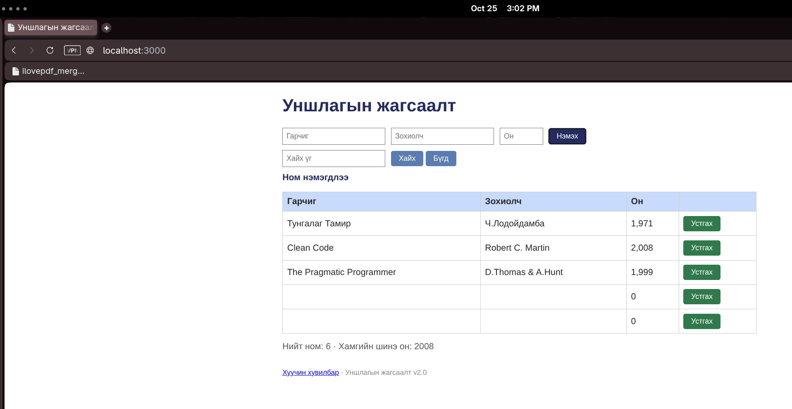

# BUG-01: Бүх талбар хоосон байхад ном нэмэгдэж байна

**Тест:** TC-01  
**Тэмдэглэлд бүртгэсэн цаг:** 15:05:41  
**Олдсон аялал:** Couch Potato Tour  

**Урьдчилсан нөхцөл:** `node app.js`-ийг шинээр асааж, `http://localhost:3000`-д нэвтэрсэн (анхны 3 ном). Тестийг давтан шалгахад серверийг зогсоож дахин асааснаар өгөгдөл цэвэрлэгдэнэ.

## Дахин гаргах алхам
1. Аппыг шинээр асаагаад хуудас нээнэ.
2. Гарчиг, Зохиолч, Он гурван талбарыг хоосон үлдээнэ.
3. `Нэмэх` товчийг дарна.
4. Хүснэгтэд нэмэгдсэн мөр болон мессежийг шалгана.

## Хүлээгдсэн үр дүн
Гурван талбар бүгд шаардлагатай; хоосон ном нэмэгдэхгүй, ойлгомжтой алдааны мессеж гарна.

## Бодит үр дүн
Хоосон гарчиг, зохиолч, 0 онтой мөр нэмэгдсэн. `Ном нэмэгдлээ` гэж харагдсан.

## Ноцтой байдал
**Major** — Заавал бөглөх мэдээлэлгүй номыг систем зөвшөөрч, өгөгдлийн бүрэн бүтэн байдлыг алдагдуулж байна.

## Нотолгоо

