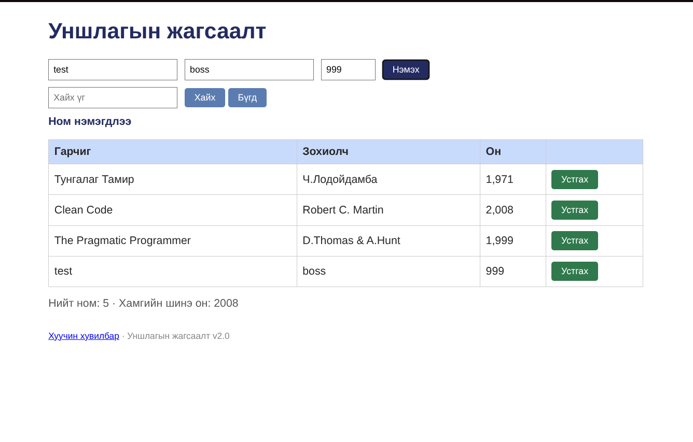

# BUG-02: Зөвшөөрөгдөөгүй 999 онтой ном нэмэгдэж байна

Орчин: Уншлагын жагсаалт v2.0, Arch Linux,
[Браузер болон хувилбар], 2026-10-20

Урьдчилсан нөхцөл:
node app.js-ийг шинээр асаасан.
Анхны 3 ном харагдана.

## Дахин гаргах алхам

1. http://localhost:3000 хуудсыг нээнэ.
2. Гарчиг: test
3. Зохиолч: boss
4. Он: 999
5. "Нэмэх" товчийг дарна.

## Хүлээгдэж байсан үр дүн

Он нь 1000–2100 хоорондох бүхэл тоо
байх ёстой. 999 онтой ном нэмэгдэхгүй.

## Бодит үр дүн

999 онтой ном хүснэгтэд нэмэгдсэн.

## Ноцтой байдал

Major — Зөвшөөрөгдөөгүй өгөгдөл
системд хадгалагдаж байна.

## Хавсралт

## Олдсон аялал

Antisocial Tour
