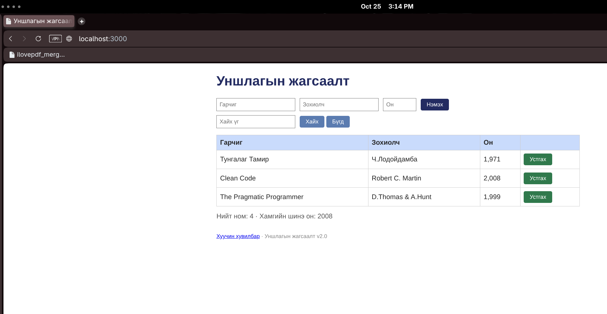

# BUG-03: Номын он мянгатын таслалтай буруу харагдаж байна

**Тест:** TC-03  
**Ажигласан цаг:** 15:14  
**Олдсон аялал:** Supermodel Tour  

**Урьдчилсан нөхцөл:** `node app.js`-ийг шинээр асааж, `http://localhost:3000`-д нэвтэрсэн (анхны 3 ном). Тестийг давтан шалгахад серверийг зогсоож дахин асааснаар өгөгдөл цэвэрлэгдэнэ.

## Дахин гаргах алхам
1. Аппыг шинээр асааж анхны номын жагсаалтыг нээнэ.
2. `Он` баганад буй утгуудыг шалгана.

## Хүлээгдсэн үр дүн
Оныг `1971`, `2008`, `1999` гэх мэт энгийн тоогоор (таслалгүй) харуулна.

## Бодит үр дүн
Утгууд `1,971`, `2,008`, `1,999` гэж харагдсан.

## Ноцтой байдал
**Minor** — Өгөгдлийн утга хэвээр боловч форматын шаардлага зөрчигдөж байна.

## Нотолгоо

