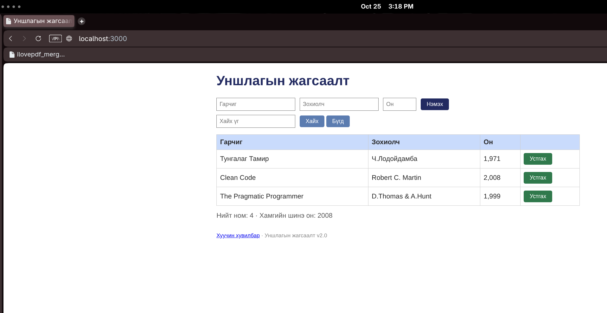

# BUG-04: Нийт номын тоолуур хүснэгтийн мөрийн тооноос нэгээр их байна

**Тест:** TC-04  
**Ажигласан цаг:** 15:18  
**Олдсон аялал:** Fed-Ex Tour  

**Урьдчилсан нөхцөл:** `node app.js`-ийг шинээр асааж, `http://localhost:3000`-д нэвтэрсэн (анхны 3 ном). Тестийг давтан шалгахад серверийг зогсоож дахин асааснаар өгөгдөл цэвэрлэгдэнэ.

## Дахин гаргах алхам
1. Аппыг шинээр асааж хуудсыг сэргээнэ.
2. Анхны жагсаалтад харагдаж буй мөрийг тоолно.
3. `Нийт ном` тоолууртай харьцуулна.

## Хүлээгдсэн үр дүн
Хүснэгтэд 3 ном байвал `Нийт ном: 3` гэж харагдана.

## Бодит үр дүн
3 мөр байгаа боловч `Нийт ном: 4` гэж харагдсан.

## Ноцтой байдал
**Major** — Хэрэглэгчид буруу тоо мэдээлж байна.

## Нотолгоо

