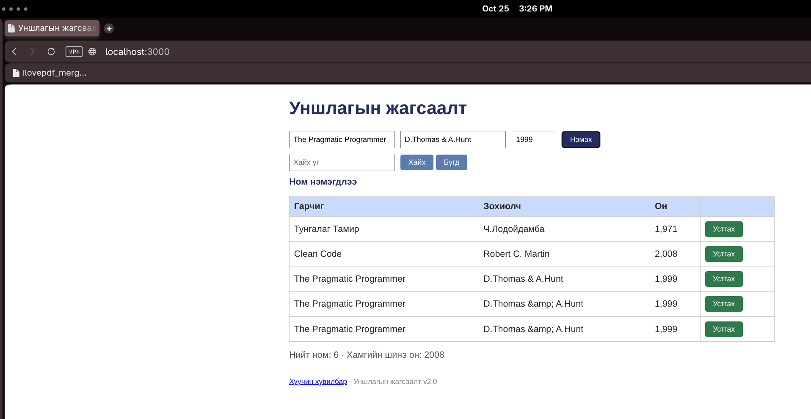

# BUG-05: Ижил номыг олон удаа нэмэх боломжтой

**Тест:** TC-06  
**Ажигласан цаг:** 15:26  
**Олдсон аялал:** Fed-Ex Tour  

**Урьдчилсан нөхцөл:** `node app.js`-ийг шинээр асааж, `http://localhost:3000`-д нэвтэрсэн (анхны 3 ном). Тестийг давтан шалгахад серверийг зогсоож дахин асааснаар өгөгдөл цэвэрлэгдэнэ.

## Дахин гаргах алхам
1. Аппыг шинээр асаана.
2. Гарчиг: `The Pragmatic Programmer`; Зохиолч: `D.Thomas & A.Hunt`; Он: `1999` оруулна.
3. `Нэмэх` товчийг хоёр удаа дарж хоёр нэмсэн мөрийг харьцуулна.

## Хүлээгдсэн үр дүн
Ижил гарчиг, зохиолчтой ном хоёр дахь удаагаа нэмэгдэхгүй.

## Бодит үр дүн
Нэг нэр, зохиолч, онтой ижил хоёр шинэ мөр нэмэгдсэн. Шинэ мөрөн дэх `&` тэмдэг `&amp;` болж дүрслэгдсэн.

## Ноцтой байдал
**Major** — Давхардсан өгөгдөл үүсэж байна.

## Нотолгоо

