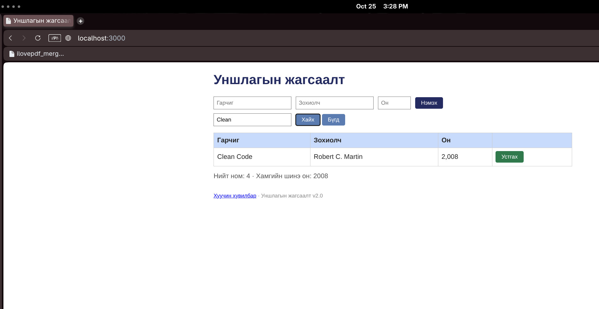
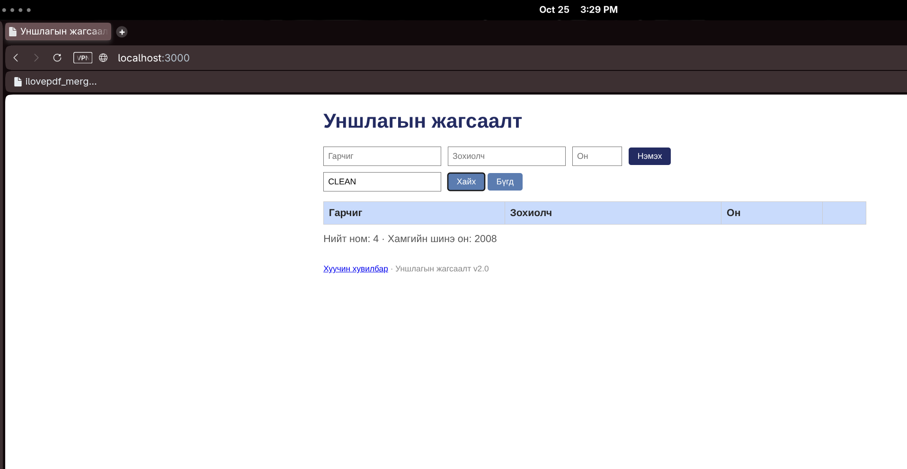

# BUG-06: Хайлт том, жижиг үсэг ялгаж байна

**Тест:** TC-07  
**Ажигласан цаг:** 15:28–15:29  
**Олдсон аялал:** Fed-Ex Tour  

**Урьдчилсан нөхцөл:** `node app.js`-ийг шинээр асааж, `http://localhost:3000`-д нэвтэрсэн (анхны 3 ном). Тестийг давтан шалгахад серверийг зогсоож дахин асааснаар өгөгдөл цэвэрлэгдэнэ.

Апп: Уншлагын жагсаалт v2.0
OS: Arch Linux
Browser: Opera 136.0.6008.80
Огноо: 2026-10-25

## Дахин гаргах алхам
1. Аппыг шинээр асаана.
2. Хайлтад `clean` оруулаад `Хайх` дарна.
3. `Бүгд` дарж хайлтыг цэвэрлэн `Clean` гэж хайна.
4. `Бүгд` дарж `CLEAN` гэж хайна.
5. Үр дүнг харьцуулна.

## Хүлээгдсэн үр дүн
Гарчиг болон зохиолчийн нэрээр хийсэн хайлт том, жижиг үсэг ялгахгүй байх ёстой. Гурван хэлбэрээр `Clean Code` олдоно.

## Бодит үр дүн
`clean` — олдоогүй; `Clean` — `Clean Code` олдсон; `CLEAN` — олдоогүй.

## Ноцтой байдал
**Major** — Хэрэглэгч яг байгаа номыг өөр үсгийн хэлбэрээр хайхад олж чадахгүй байна.

## Нотолгоо

