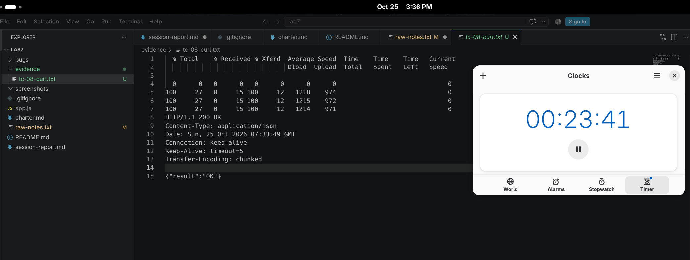

# BUG-07: Буруу JSON биетэй POST хүсэлтэд HTTP 200 буцааж байна

**Тест:** TC-08  
**Ажигласан цаг:** 15:33:49  
**Олдсон аялал:** Saboteur Tour  

**Урьдчилсан нөхцөл:** `node app.js`-ийг шинээр асааж, `http://localhost:3000`-д нэвтэрсэн (анхны 3 ном). Тестийг давтан шалгахад серверийг зогсоож дахин асааснаар өгөгдөл цэвэрлэгдэнэ.

## Дахин гаргах алхам
1. Серверийг `node app.js` командаар шинээр асаана.
2. Өөр terminal-д дараах командыг ажиллуулна:

```bash
curl -i -X POST http://localhost:3000/api/books \
  -H "Content-Type: application/json" \
  --data-binary 'invalid json' \
  2>&1 | tee evidence/bug-07-curl.txt
```
3. HTTP статус болон response body-г шалгана.

## Хүлээгдсэн үр дүн
Эвдэрхий JSON биетэй POST хүсэлтэд `HTTP 400 Bad Request` буцаана.

## Бодит үр дүн
`HTTP/1.1 200 OK` болон `{"result":"OK"}` буцсан.

## Ноцтой байдал
**Major** — Буруу бүтэцтэй хүсэлтийг амжилттай гэж боловсруулж байна.

## Нотолгоо
**Заавал шаардагдах API нотолгоо:** [evidence/bug-07-curl.txt](../evidence/bug-07-curl.txt)

Нэмэлт screenshot: 
