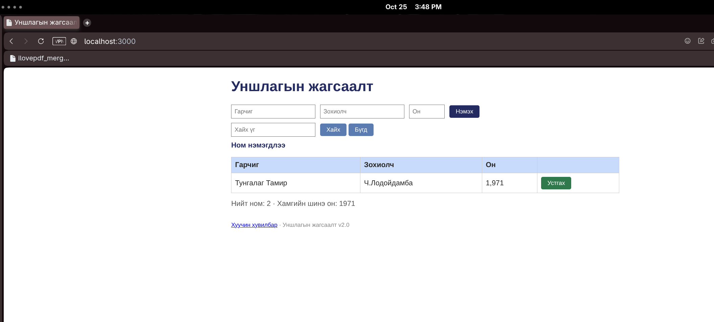

# BUG-08: Ном устгах үед тохирох амжилтын мессеж харагдахгүй

**Тест:** TC-11  
**Ажигласан цаг:** 15:48 орчим  
**Олдсон аялал:** Supermodel Tour  

**Урьдчилсан нөхцөл:** `node app.js`-ийг шинээр асааж, `http://localhost:3000`-д нэвтэрсэн (анхны 3 ном). Тестийг давтан шалгахад серверийг зогсоож дахин асааснаар өгөгдөл цэвэрлэгдэнэ.

## Дахин гаргах алхам
1. Аппыг шинээр асааж анхны 3 номтой хуудас нээнэ.
2. `Clean Code` мөрийн `Устгах` товчийг дарна.
3. Мөр арилсан эсэх болон дэлгэцийн мессежийг шалгана.

## Хүлээгдсэн үр дүн
Ном устаж, устгасан үйлдэлтэй тохирсон мессеж харагдана.

## Бодит үр дүн
`Clean Code` мөр арилсан. Устгасныг баталгаажуулсан шинэ мессеж ажиглагдаагүй; screenshot дээр `Ном нэмэгдлээ` текст харагдсан.

## Ноцтой байдал
**Minor** — Устгасан үр дүнгийн талаар буруу/дутуу санал хүсэлт өгч байна.

## Нотолгоо

