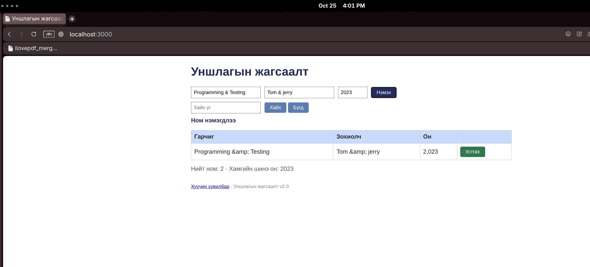

# BUG-09: Амперсанд тэмдэг `&amp;` болж дүрслэгдэж байна

**Тест:** TC-12  
**Ажигласан цаг:** 16:01  
**Олдсон аялал:** Fed-Ex Tour  

**Урьдчилсан нөхцөл:** `node app.js`-ийг шинээр асааж, `http://localhost:3000`-д нэвтэрсэн (анхны 3 ном). Тестийг давтан шалгахад серверийг зогсоож дахин асааснаар өгөгдөл цэвэрлэгдэнэ.

## Дахин гаргах алхам
1. Аппыг шинээр асаана.
2. Гарчиг: `Programming & Testing`; Зохиолч: `Tom & jerry`; Он: `2023` оруулна.
3. `Нэмэх` товчийг дарна.
4. Жагсаалтын шинээр нэмэгдсэн мөрийг шалгана.

## Хүлээгдсэн үр дүн
Гарчиг, зохиолчид оруулсан `&` тэмдэг өөрчлөгдөхгүйгээр харагдана.

## Бодит үр дүн
`Programming &amp; Testing` болон `Tom &amp; jerry` гэж дүрслэгдсэн. 

## Ноцтой байдал
**Minor** — Хэрэглэгчийн өгөгдөл буруу текстэн дүрслэлтэй болж байна.

## Нотолгоо

